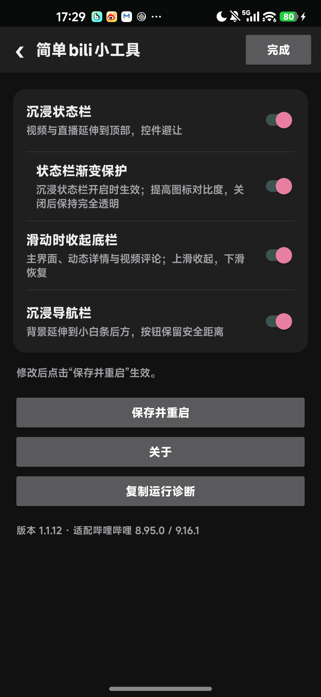

# 简单bili小工具

[](https://github.com/weinaoa/easybilitool/releases/latest)


[](LICENSE)

**简体中文** · [English](README_EN.md)

为哔哩哔哩 Android 客户端提供系统栏沉浸与滑动收起底栏的 LSPosed 模块。保留原生界面，让背景延伸到系统栏区域，同时为按钮、输入栏和列表末项保留安全距离。

[下载](https://github.com/weinaoa/easybilitool/releases/latest) · [更新记录](docs/CHANGELOG.md) · [问题反馈](https://github.com/weinaoa/easybilitool/issues) · [开发与验证](docs/TESTING.md)

## 功能特性

- **沉浸状态栏**：视频、Story 竖屏视频和直播背景延伸到顶部，保留系统状态图标，并为操作控件避让。
- **沉浸导航栏**：页面及弹层背景延伸到系统导航区，固定按钮、评论输入栏和列表末项保留安全距离。
- **滑动时收起底栏**：首页、动态详情和视频评论底栏随上滑逐步下移、渐隐，下滑恢复。

沉浸状态栏提供默认开启的“状态栏渐变保护”子选项，使用 AndroidX 官方组件改善图标对比度；关闭后透明，沿用客户端选择的图标明暗。

## 界面预览



## 使用要求

| 项目 | 要求 |
| --- | --- |
| 适配客户端 | 官方哔哩哔哩 **8.95.0** |
| Android | **8.0 及以上** |
| 框架 | Root，支持 **libxposed API 102** 的 LSPosed 框架 |
| 作用域 | 哔哩哔哩 **`tv.danmaku.bili`** |

## 安装与使用

1. 从 [Releases](https://github.com/weinaoa/easybilitool/releases) 下载并安装模块 APK。
2. 在框架中启用“简单bili小工具”，作用域勾选 **哔哩哔哩**。
3. 强行停止并重新打开哔哩哔哩，进入 **我的 → 设置 → 简单bili小工具**；也可从模块桌面入口选择“打开功能设置”。
4. 按需启用功能，点击 **保存并重启**。

首次安装时三项主功能均关闭，渐变保护仅随沉浸状态栏生效。设置在保存前属于编辑草稿；退出未保存时可继续编辑或放弃。

同包名、相同签名的 APK 可以覆盖升级。配置保存在哔哩哔哩私有目录，清除客户端数据会清除配置。模块不申请网络或存储权限。

## 常见问题

**找不到设置入口或功能没有生效？**

确认框架支持 API 102、作用域已勾选，并在启用或更新模块后强停重开客户端。修改设置后需“保存并重启”。

**出现黑边、遮挡或底栏异常？**

先单独启用本模块复现，检查客户端版本和有关开关。关闭对应功能并保存重启可撤回调整。反馈时请说明导航栏沉浸开启、关闭时的区别。

## 从源码构建

技术栈：**Kotlin、Android View、现代 libxposed API**，使用 AndroidX 处理系统栏保护与边衬。

需要 **JDK 17+、Android SDK Platform 36、Build Tools 36.0.0、Python 3.10+**。通过 `ANDROID_SDK_ROOT` / `ANDROID_HOME` 或本地 `local.properties` 配置 SDK。

```powershell
.\gradlew.bat :app:assembleDebug :app:lintDebug
python tools/test.py
python tools/audit_apk.py
python package_source.py
```

Linux / macOS 首行使用 `bash ./gradlew :app:assembleDebug :app:lintDebug`。首次构建需要下载依赖。

APK 输出到 `app/build/outputs/apk/debug/`；打包后的 APK、源码 ZIP 和 SHA-256 校验值位于 `dist/`。详细流程见[构建与发布](docs/RELEASE.md)。

## 反馈与贡献

欢迎通过 [Issues](https://github.com/weinaoa/easybilitool/issues) 反馈问题，通过 Pull Request 提交修复。请提供模块版本、客户端版本、Android／框架版本、导航方式、有关开关和复现步骤；截图与日志请遮盖个人信息。

贡献前请阅读 [AGENTS.md](AGENTS.md)，保留旧客户端适配路径，注明代码来源与授权。具体测试结果见[验证文档](docs/TESTING.md)，历史变化见[更新记录](docs/CHANGELOG.md)。

## 来源与许可

本项目自有代码、文档和图标采用 **Mulan PubL v2（木兰公共许可证，第2版）**，Copyright (c) 2026 weinaoa。完整文本见 [LICENSE](LICENSE)，第三方依赖保留各自许可。

感谢 BBZQ、哔哩漫游及 Android 官方文档提供的机制与接口参考。具体范围见[源码来源](docs/SOURCES.md)、[第三方声明](THIRD_PARTY_NOTICES.md)及[图标来源](docs/ARTWORK.md)。
