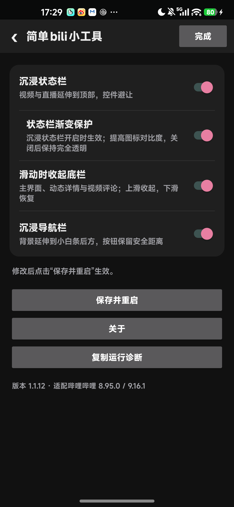

# EasyBiliTool

[](https://github.com/weinaoa/easybilitool/releases/latest)


[](LICENSE)

[简体中文](README.md) · **English**

> **Discontinued on November 18, 2026:** Due to maintenance complexity, this project no longer schedules new features, bug fixes or support for newer app versions. Existing source, releases, validation records and the Mulan PubL v2 license remain available. The usage and build instructions below describe historical versions and do not promise continued compatibility.

An LSPosed module for the official Bilibili Android app. Extend backgrounds behind the system bars and collapse bottom bars while scrolling, keeping controls and the last list item clear of the system navigation area.

[Historical releases](https://github.com/weinaoa/easybilitool/releases) · [Changelog](docs/CHANGELOG.md) · [Issue history](https://github.com/weinaoa/easybilitool/issues) · [Build and validation records](docs/TESTING.md)

## Features

- **Status bar immersion:** extend video, Story and live backgrounds to the top while keeping status icons and controls visible.
- **Navigation bar immersion:** extend page and panel backgrounds into the navigation area while preserving safe spacing for controls and list items.
- **Scroll to collapse:** gradually move and fade bottom bars on the home page, dynamic posts and video comments; scroll down to restore them.

Status bar immersion includes optional AndroidX gradient protection, enabled by default. Turning protection off leaves the bar transparent and retains the app's icon appearance.

## Preview



## Requirements

| Item | Requirement |
| --- | --- |
| App | Official Bilibili **8.95.0** |
| Android | **8.0+** |
| Framework | Root and an LSPosed framework supporting **libxposed API 102** |
| Scope | Bilibili **`tv.danmaku.bili`** |

## Installation and use

1. Download and install the APK from [Releases](https://github.com/weinaoa/easybilitool/releases).
2. Enable the module in your framework and select Bilibili as its scope.
3. Force stop and reopen Bilibili. Open **My → Settings → 简单bili小工具**, or use the module's launcher shortcut to open feature settings.
4. Enable the features you want and tap **保存并重启** (Save and restart).

All three main features are disabled on first installation. Gradient protection applies only when status bar immersion is enabled. Changes remain a draft until saved.

Updates require the same package name and signing key. Configuration is stored in Bilibili's private directory; clearing Bilibili data removes it. The module requests no network or storage permissions.

## Troubleshooting

If settings are missing or changes do not apply, check framework API support and scope, then force stop and reopen the app. Save your changes before restarting.

For layout issues, reproduce with only this module enabled and compare navigation immersion on and off. Disabling the relevant feature and saving restores its adjustments.

Existing issues remain available for reference; no further fixes or compatibility updates are scheduled.

## Build

Built with **Kotlin, Android Views and the modern libxposed API**, with AndroidX system bar protection and insets support.

Install **JDK 17+, Android SDK Platform 36, Build Tools 36.0.0 and Python 3.10+**. Configure the SDK through environment variables or a local `local.properties` file.

```powershell
.\gradlew.bat :app:assembleDebug :app:lintDebug
python tools/test.py
python tools/audit_apk.py
python package_source.py
```

On Linux/macOS, replace the first command with `bash ./gradlew :app:assembleDebug :app:lintDebug`. The first build downloads dependencies. APKs are generated in `app/build/outputs/apk/debug/`; packaging writes the APK, source ZIP and SHA-256 checksums to `dist/`.

See the [build and release guide](docs/RELEASE.md) for details.

## Historical records and independent development

[Issues](https://github.com/weinaoa/easybilitool/issues) and existing Pull Requests remain as historical records, without a maintenance or response schedule. Further development can continue in independent forks under the existing license and attribution requirements.

See [AGENTS.md](AGENTS.md) for the discontinuation scope and any explicitly requested final changes. [Validation documents](docs/TESTING.md) record historical tests, not verification of newer systems or app versions.

## Credits and license

Project-owned code, documentation and artwork are licensed under **Mulan PubL v2**, Copyright (c) 2026 weinaoa. See [LICENSE](LICENSE). Dependencies retain their own licenses.

Thanks to BBZQ, BiliRoaming and Android documentation for mechanism and API references. See [source attribution](docs/SOURCES.md), [third-party notices](THIRD_PARTY_NOTICES.md) and [artwork attribution](docs/ARTWORK.md).
